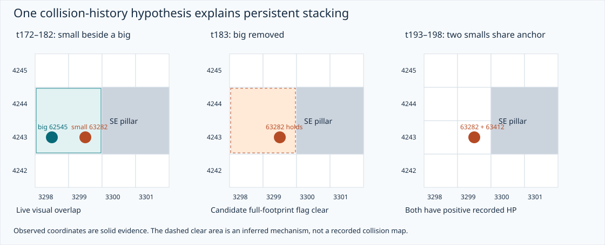

# Nylocas pillar pathing research

Studied 2026-10-18. Scope: regular Theatre of Blood, six solo and eight duo recordings, ordinary pillar attackers of both sizes. No simulator implementation was changed.

The main correction to investigate is **collision history**, followed by the **local movement decision when an approach is blocked**. Current contact geometry already explains many arrivals. Searching every free pillar contact does not explain the strong tendency to remain near a crowded approach; treating every live anchor as permanently occupied does not explain persistent stacks. These mechanisms need evaluating together: missed collision clears can make a simulated pillar appear fuller and cause extra pacing or wrapping. [Observations and counts](observations.md), [current source audit](engine-audit.md), [proposed corrections](corrections.md).

The strongest new evidence is 157 arrival/incumbent pairs where a nylo **moves onto an anchor already held by another ordinary positive-HP nylo**, and both remain there. Every pair has an earlier candidate collision-clear event during the incumbent's continuous hold: another actor leaves that exact anchor, or an ordinary big disappears with its other footprint tiles covering it. Of these, 26 have only the covering-big-removal explanation among the events searched. This supports testing size-one movement/reservation with a broader big cleanup footprint and persistent collision bits. It does **not** directly reveal the server's collision map or prove an exact cleanup instruction. [Method and witnesses](observations.md#persistent-stacks-and-collision-history), [all admissions](summary.json).



The four user leads resolve as follows:

| Lead | What these recordings support | Consequence |
| --- | --- | --- |
| Reluctance to wrap around the pillar | Congested small/big traces retry locally; none of the 731 lane lifetimes with sustained assigned-pillar contact later establishes sustained contact on another face of that pillar. That last statistic measures behavior after settling, not every pre-contact approach. | Keep settled actors still; replace automatic searches of every free face with a geometric approach and local retries. Exact retry rules remain unresolved. |
| Straight and diagonal pacing | 124 five-tick windows alternate cardinal and diagonal out-and-back excursions; both sizes are represented. A separate big case repeats a triangle. | Cardinal-only out-and-back pacing is insufficient as the explanation. Do not add a forced straight/diagonal alternation timer: the traces also contain repetitions and irregular changes. |
| Waves 25/27 east bigs reach SE's north side; 27 may overhang | All 27 sustained arrivals among 28 observed spawns use the north side; one is killed before sustained contact. No coordinate-confirmed boundary overhang was found for these spawns. | Preserve their common geometry and target. Current code already predicts north-side arrivals and can allow visual overhang; no wave-specific fix is justified. |
| Too much pacing; usually no more than two stacked | Near-pillar movement is a minority of qualifying intervals. Persistent same-anchor doubles occur in every recording; triples occur rarely in five recordings. | Investigate missing flag clears before tuning pacing frequency. A fixed capacity of two contradicts the triples. |

Each result above is derived from [checksum-checked raw event snapshots](manifest.json); the per-recording comparisons, definitions and limits are in [observations.md](observations.md). The game-engine recommendations and their confidence are in [corrections.md](corrections.md).

## Reading and reproducing the evidence

- [observations.md](observations.md): recording-by-recording comparison, stages/sizes, exact coordinate witnesses, and unconfirmed leads.
- [corrections.md](corrections.md): coherent proposed changes, pseudocode, alternatives and acceptance cases.
- [engine-audit.md](engine-audit.md): current Kotlin behavior, source links, route-result semantics, collision operations and actor order.
- [cases.json](cases.json): eight extracted windows with focal metadata and **all observed wave/split NPC events** in each window, including fighting forms as possible surrounding blockers. Events are observations, not reconstructed server flags.
- [contact-runs.json](contact-runs.json): all 1,190 initially pillar-directed lane lifetimes, including those killed before sustained contact. Holds require two consecutive ordinary-form positive-HP observations on one contact anchor.
- [summary.json](summary.json): all counts, mixed reversals, stable overlaps and occupied-anchor arrivals. Repeated ticks/windows/pairs are explicitly not independent trials.
- [manifest.json](manifest.json): new duo response hashes, prior corpus reference, classification hash and audited repository revisions. The earlier 13 raw recordings remain in [the existing corpus](../research/nylocas/README.md).

From the repository root, with Python 3 and no dependencies or network:

```bash
python docs/nylo-pathing/analyze.py
python docs/nylo-pathing/figures.py
```

The first command checks every input response hash, validates regular mode/scale/lost-tick metadata and regenerates the three JSON outputs. The second regenerates the two SVG coordinate diagrams from those extracted cases. Neither runs or modifies the simulator. Source-level predictions have been distinguished from executed simulator comparisons; no full engine-versus-replay parity claim is made.

## Evidence boundary

An implementation follow-up is now available on `nylo-pathing-corrections`:
[verification.md](verification.md) describes the implemented collision and
movement changes, the additional diagonal-side evidence, source review and
recording comparisons. The research statements above describe the original
audit snapshot; see that follow-up for the current implementation.

Blert exposes observed positions, NPC IDs, HP estimates and spawn/removal events; it does not expose the server collision flags, regular-NPC target, pillar hits, exact slot processing order, or every death sub-phase. The cited replay pages are backed by archived API responses, since the web text extractor could not render the interactive recordings. This investigation studies their recorded tick coordinates rather than claiming a visual playback review.

The findings identify the engine seams that need changing or testing. They do not uniquely recover the retry direction algorithm or its possible randomness. The remaining ambiguity, candidate policies, and the observations needed to distinguish them are recorded in [corrections.md](corrections.md); replacing them with scenario-specific patches would overstate the evidence.
