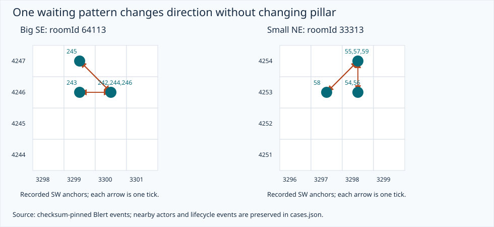

# Recording observations and current-engine comparisons

All numbers here are recomputed by [analyze.py](analyze.py) from 14 SHA-256-verified first-party Blert event/metadata responses. The sample is six solos/eight duos, regular mode 11, all with zero **reported** lost ticks. It contains 2,884 wave/split lifetimes: 602 big and 2,282 small. The initial pillar-directed lane subset has 85 physical spawn fingerprints per recording, 1,190 lifetimes total. Classification uses the [earlier audited fingerprint table](../research/nylocas/lane-spawn-targets.csv), whose bytes are pinned in the [new manifest](manifest.json). A target is an inference from prior repeated contacts, not a server target field.

Coordinates are southwest tile anchors, X east/Y north. Pillars occupy 2×2: SW `(3290,4243)`, SE `(3300,4243)`, NW `(3290,4253)`, NE `(3300,4253)`. The inclusive arena rectangle is X3290–3301/Y4243–4254. Ordinary native IDs are 8342–8347; fighting IDs are excluded from focal observations, even if a guide classified their original spawn as pillar-directed. Surrounding fighting NPCs remain in [cases.json](cases.json), because they can affect traffic. The [prior source audit](../nylocas-mechanics-source-audit.md) documents recorder coordinates/IDs and its limitations.

## Per-recording comparison

The same source-based prediction is checked against every recording: current movement normally rejects a reserved destination anchor, while settled actors remain still. Persistent arrival onto another actor's live anchor therefore needs a collision-history explanation. Every recording contains stable same-anchor observations; most contain mixed-direction reversals as well. The engine's explicit pacing branch predicts cardinal out-and-back motion, though its route-search branches can also produce diagonals. These are branch-level comparisons, not claimed exact next-tile predictions from an executed simulator. Full source predictions and conditions are in [engine-audit.md](engine-audit.md).

| Recording | Scale | Lane lifetimes with sustained assigned contact /85 | Moving / qualifying near intervals | Mixed reversal windows | Stable same-anchor pair-ticks | Stable triple anchor-ticks |
| --- | --- | --- | --- | --- | --- | --- |
| [1073635f](https://blert.io/raids/tob/1073635f-5326-4bac-a147-8fdf6299f761/nylocas) | 2 | 38 | 129/871 | 9 | 99 | 0 |
| [4ed0a471](https://blert.io/raids/tob/4ed0a471-7c3a-46d7-8f9c-e807f0275be3/nylocas) | 2 | 37 | 147/1016 | 6 | 91 | 0 |
| [65c9f142](https://blert.io/raids/tob/65c9f142-f240-4284-9384-d32fa313067e/nylocas) | 1 | 65 | 294/1964 | 14 | 224 | 6 |
| [9ac3826e](https://blert.io/raids/tob/9ac3826e-aa64-4f5a-b00f-4208f97f0307/nylocas) | 2 | 47 | 119/1229 | 0 | 164 | 11 |
| [9f8f1a77](https://blert.io/raids/tob/9f8f1a77-a528-454f-bfac-8251dec9de32/nylocas) | 2 | 51 | 202/1236 | 12 | 176 | 0 |
| [a37210fe](https://blert.io/raids/tob/a37210fe-5737-480f-8fca-518e56205e9b/nylocas) | 1 | 64 | 305/1928 | 22 | 190 | 7 |
| [bbd10de2](https://blert.io/raids/tob/bbd10de2-8831-4b53-9872-970d547d3a5d/nylocas) | 2 | 46 | 148/1228 | 5 | 132 | 0 |
| [bef6ad10](https://blert.io/raids/tob/bef6ad10-3ef3-48b7-97a5-d019cf9ba303/nylocas) | 2 | 53 | 185/1383 | 10 | 160 | 0 |
| [c77441a7](https://blert.io/raids/tob/c77441a7-3caf-4d9d-a482-8ffe8d7f293d/nylocas) | 2 | 31 | 153/878 | 2 | 123 | 0 |
| [df03c4dc](https://blert.io/raids/tob/df03c4dc-1e1d-4f57-8e6c-403803205659/nylocas) | 1 | 60 | 232/1892 | 10 | 209 | 0 |
| [eb3793f3](https://blert.io/raids/tob/eb3793f3-ce4a-4fcf-8ef9-e2098d39914a/nylocas) | 1 | 70 | 249/2147 | 9 | 331 | 28 |
| [ebaeaf20](https://blert.io/raids/tob/ebaeaf20-9862-4548-af9f-1a37c52b020a/nylocas) | 1 | 60 | 239/1902 | 11 | 187 | 0 |
| [fc7d6eaa](https://blert.io/raids/tob/fc7d6eaa-eaec-43e5-ae66-6be8364ad312/nylocas) | 1 | 62 | 252/1895 | 11 | 277 | 3 |
| [653f90c7, supplied](https://blert.io/raids/tob/653f90c7-176b-4fd4-a0eb-1cbd818481ce/nylocas) | 2 | 47 | 149/1125 | 3 | 87 | 0 |

All 14 rows use the same filters. Zero reversal/triple counts mean none passed those narrow filters, not that all other congestion or stacking was absent. Kills before arrival explain many missing contacts; they are not route failures. Full UUIDs, NPC identities, tick ranges and results are in [summary.json](summary.json) and [contact-runs.json](contact-runs.json).

## Stages and both sizes

For the 1,190 initially pillar-directed lane lifetimes, a near interval consists of two consecutive positive-HP ordinary-form observations whose anchors are each within Chebyshev distance two of a **geometric** contact anchor for the assigned pillar and actual size. Natural expiry animation ages are excluded: small age≥51, big age≥52. Terrain is not reconstructed when calculating this metric. A moving interval changes anchor; it includes final approach and local retries, so it is **not a pure pacing rate**.

| Spawn waves | Size | Moving / near intervals | Moving proportion |
| --- | --- | --- | --- |
| 1–9 | Small | 331/3,258 | 10.2% |
| 1–9 | Big | 51/350 | 14.6% |
| 10–20 | Small | 479/3,571 | 13.4% |
| 10–20 | Big | 294/3,740 | 7.9% |
| 21–31 | Small | 1,320/6,146 | 21.5% |
| 21–31 | Big | 328/3,629 | 9.0% |

Overall 2,803/20,694 near intervals move. This is consistent with grouping and long holds rather than continuous pacing; it does not quantify how much the simulator overpaces without equivalent simulator output and matched kill histories. Late smalls show more movement than mid-room bigs, so imposing one universal pacing probability would obscure the observed difference. The grouping behavior itself agrees with the current immediate stop on valid contact. [Raw counts](summary.json).

Across 731 lane lifetimes with two consecutive ordinary positive-HP observations on the assigned pillar, no later sustained contact run changes face on that same assigned pillar. This is a check on **settled stability**, which the current engine already implements. It cannot establish how often a blocked newcomer crosses between faces before ever settling. Late transformations and other-pillar retargeting are excluded by that measure; do not use it to prohibit all side changes. [All contact runs](contact-runs.json).

## Local retries include straight, diagonal and triangular motion

The narrow mixed-reversal detector asks for five consecutive active observations with positions `A→B→A→C→A`, one excursion cardinal and the other diagonal. There are 124 overlapping windows in 13 recordings: 120 small, four big. These are windows, not 124 independent episodes. The coordinates, NPC IDs and ticks are stored under `mixed_cardinal_diagonal_reversal_windows` in [summary.json](summary.json).

Three representative cases cover different pillars and sizes; [cases.json](cases.json) preserves every nearby wave/split actor's recorded state, not just the moving focal NPC:

| Replay / focal | Exact sequence | Current prediction and implication |
| --- | --- | --- |
| [Solo eb3793f3](https://blert.io/raids/tob/eb3793f3-ce4a-4fcf-8ef9-e2098d39914a/nylocas), wave6 small `33313`, NE | t53 `(3298,4254)`;54 `(3298,4253)`;55 `(3298,4254)`;56 `(3298,4253)`;57 `(3298,4254)`;58 `(3297,4253)`;59 `(3298,4254)`;60 `(3299,4254)` | The initial cardinal loop fits remembered return pacing. The later diagonal excursion needs another decision. Global routing to another free contact is allowed by the current source but is not what this local trace does. |
| [Duo 1073635f](https://blert.io/raids/tob/1073635f-5326-4bac-a147-8fdf6299f761/nylocas), wave27 big `64113`, SE | t242 `(3300,4246)`;243 `(3299,4246)`;244 `(3300,4246)`;245 `(3299,4247)`;246 `(3300,4246)`. Further straight and diagonal reversals precede settling at `(3300,4245)` at257. | Explicit `pace()` cannot make245's diagonal. Whole-engine impossibility is not established because BFS can move diagonally. The north approach stays local while blocked, then takes a vacancy. |
| [Solo a37210fe](https://blert.io/raids/tob/a37210fe-5737-480f-8fca-518e56205e9b/nylocas), wave25 south big `34729`, SW | t339–349 repeats `(3293,4244)→(3293,4243)→(3294,4243)→(3293,4244)`;350 reaches `(3292,4244)` | A permanently paired return tile cannot alone explain a triangle. Local target attempts, blocker changes and/or retry choices must be considered together. |

These cases reject explaining all congestion by a FIFO standstill, only cardinal bouncing, or a forced straight/diagonal alternation. They do not identify a unique deterministic direction ordering or prove randomness. Neighboring actors and server turn order can change a deterministic next step. At some vacancy handoffs the old NPC is still visible/positive-HP one tick before removal, so available collision must be distinguished from rendered bodies. [Current branch analysis and lifecycle source](engine-audit.md).

## Persistent stacks and collision history

The stable-stack filter is independent of inferred pillar targets. Both actors must be ordinary forms with positive observed HP, each at least two ticks old and younger than age49 for smalls/50 for bigs at t−1,t,t+1. Both anchors must be inside the arena and unchanged across those three ticks. This excludes birth coincidences and the final natural-expiry window; it cannot rule out every lagging HP observation.

It finds 2,450 stable same-anchor pair-ticks: 2,156 small/small and 294 big/small, with no big/big pairs under this filter. They occupy 2,340 unique anchor-ticks: 2,285 doubles and 55 triples. Triples are 2.35% of those stacked anchor-ticks, present in five recordings. These duration-weighted counts are not probabilities that a newly arriving NPC will stack. They confirm the “usually two” lead while ruling out a hard maximum of two. [Every matched pair/triple](summary.json).

The stricter **arrival** filter requires the newcomer to move onto the tile, the incumbent to hold it at t−2 and t−1, and both to remain at t,t+1,t+2, with the same safe-age/ordinary/HP criteria. This produces 157 incoming/incumbent pairs. A triple may contribute multiple pairs. For each pair the search goes back through the incumbent's continuous ordinary positive-HP stationary run, **including its first arrival tick**, and records:

1. Any other NPC leaving or being removed from that exact anchor.
2. Removal of an ordinary big whose 2×2 footprint covers that anchor through a tile other than its southwest anchor.

All 157 pairs have at least one such candidate: 91 exact-anchor events only, 26 covering-big removals only, 40 both. The search does not require immediate entry after a clear; a stationary actor could keep a missing bit for many ticks. Nor does this analysis calculate a control/background event rate or replay a reconstructed server collision map. It is evidence favoring a mechanism, not proof that the candidate caused every arrival. [Algorithm](analyze.py), `occupied_anchor_admissions` in [summary.json](summary.json).

**Witness 1: neighboring big removal, delayed double.** In [duo 1073635f](https://blert.io/raids/tob/1073635f-5326-4bac-a147-8fdf6299f761/nylocas), split small `63282` holds `(3299,4243)` from172 through198 with8HP. Big `62545` at `(3298,4243)` is removed at183. Its eastern footprint tile covers the small. Lane small `63412` advances `(3297,4243)` at191 → `(3298,4243)` at192 → `(3299,4243)` at193 and remains through198, also with8HP. There is no exact-anchor departure during the incumbent's hold before193. The current big removal only clears its southwest reservation; strict occupancy would block this incoming step. A full-extent cleanup clear at183 would leave a persistent hole and explain it. See `big-removal-persistent-hole` in [cases.json](cases.json) and [diagram](stacking.svg).

**Witness 2: exact-anchor release on the replacement's arrival tick.** In [solo df03c4dc](https://blert.io/raids/tob/df03c4dc-1e1d-4f57-8e6c-403803205659/nylocas), small `59710` is removed from `(3291,4245)` at305 as `59665` arrives. The latter holds with8HP. Small `59667` moves onto the same anchor at308; both remain through312 with8HP. This supports testing a release after the first replacement's collision set, leaving a persistent hole for the second. It does not reveal exact server ordering. See `same-tick-release-persistent-hole` in [cases.json](cases.json).

**Witness 3: a durable triple reached by movement.** In [solo 65c9f142](https://blert.io/raids/tob/65c9f142-f240-4284-9384-d32fa313067e/nylocas), small `53449` reaches `(3300,4245)` at414; `53579` moves onto it at422; `53734` moves onto it at427. All three remain there with8HP through at least431; the strict stable filter passes428–430. Each was born elsewhere. This is neither a three-child birth coincidence nor a one-tick death handoff. The first later leaves at its lifecycle boundary; the others become fighting forms at444 and are no longer focal observations. See `three-small-stack` in [cases.json](cases.json).

This resolves a gap in the [older occupancy evidence](../nylocas-occupancy-evidence.md), which established different-anchor visual overlap but left universal anchor exclusion unsettled. The new evidence contradicts that stronger exclusion. The older implementation follow-up correctly describes the present code but should not be read as proof that preserving all neighboring flags on big death matches the real room.

## Waves 25 and 27: north side confirmed, boundary overhang unconfirmed

There are 28 relevant east-lane big spawns in the 14 recordings. Wave25 has sustained SE contact in14/14; wave27 in13/14. All27 first sustained contacts are on the north side, anchored `(3299,4245)` or `(3300,4245)`. The remaining wave27 big, duo4ed0a471 `38695`, has no sustained assigned contact. No ordinary positive-HP target-contact event in this subset has a 2×2 extent outside X3290–3301/Y4243–4254. “Model protrudes beyond scenery” is a different visual claim that these anchor coordinates cannot settle. [Per-spawn results](summary.json).

In the [task-supplied duo](https://blert.io/raids/tob/653f90c7-176b-4fd4-a0eb-1cbd818481ce/nylocas), wave25 `36500` takes236 `(3301,4248)` →237 `(3300,4247)` →238 `(3300,4246)` →239 `(3299,4245)`, holding through254. Existing free-endpoint selection can explain that result because `(3300,4245)` and `(3301,4245)` already have other actors. Wave27 `37040` takes260 `(3301,4248)` →261 `(3300,4247)` →262 `(3300,4246)` →263 `(3299,4246)` →264 `(3300,4246)` →265 `(3299,4245)`, holding through306. On262 the dying wave25 big births a child directly onto the approaching big's anchor and another on its intended contact; these events matter to any prediction. Both windows are preserved in [cases.json](cases.json).

The current size-aware geometry already predicts a near north approach for both spawns. It also already permits the candidate anchor `(3301,4245)` when terrain permits, which would visibly extend east to3302. Therefore neither a special wave27 target nor a blanket map-boundary expansion follows from the observations. [Exact source prediction](engine-audit.md#contact-geometry-and-the-wave-2527-lead).

## Implementation follow-up: NPCs on diagonal side tiles

Building a real-engine comparison exposed another collision distinction. In [duo1073635f](https://blert.io/raids/tob/1073635f-5326-4bac-a147-8fdf6299f761/nylocas), lane small `61705` moves from `(3298,4243)` at88 to `(3299,4244)` at89 while small `61590` holds the diagonal's side tile `(3299,4243)` from81, with positive recorded HP before and after the move. No searched exact-anchor departure or covering-big removal occurs during that incumbent's hold. The destination is different from the occupied side tile.

The [additional extractor](../../tools/research/nylocas_corners.py) finds **624 transition/side pairs**, 571 involving moving smalls and53 moving bigs, across the pinned corpus. It requires safe ages/ordinary positive-HP forms and an unchanged side occupant at t−1,t,t+1,t+2; it screens both previously identified collision-clear mechanisms throughout the side occupant's continuous hold. [All witnesses and method](verification/corner-evidence.json). Counts repeat actors/episodes and cannot exclude unobserved server mechanisms.

This supports testing NPC collision at the **destination** while retaining terrain/wall checks on diagonal side tiles. The original shared step validator includes `BLOCK_NPCS` at the side tiles as well, so it rejects the witness if the observed occupant still has its bit. This is a separate issue from size-two visual overlap or broader death cleanup; the moving-small witnesses do not require any big's movement footprint. The implemented correction and its focused regression are described in [verification.md](verification.md).
